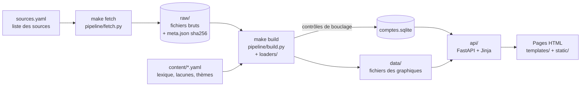
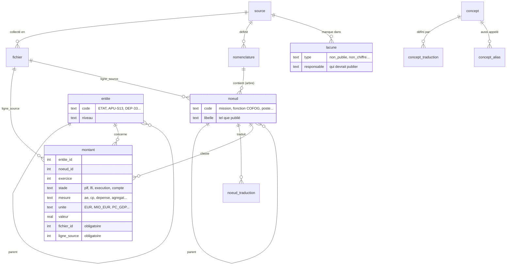
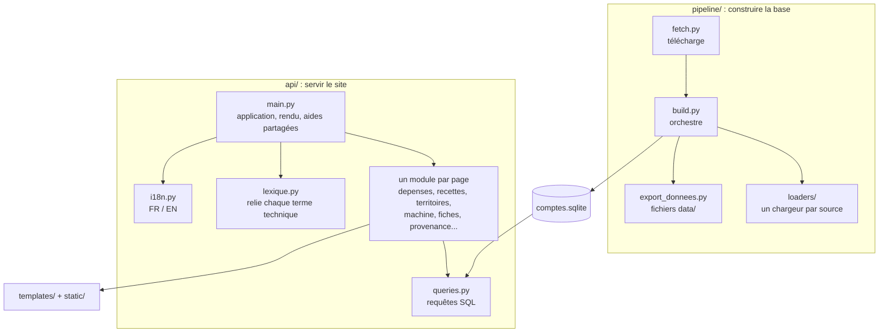

# Architecture

## 1. Du fichier officiel à la page

Rien n'est saisi à la main : tout part d'un fichier téléchargé, gardé tel quel, puis chargé dans une base SQLite.

- **raw/** n'est jamais modifié : chaque collecte crée un dossier daté. C'est la preuve de provenance.
- **make build** échoue si un total recalculé ne correspond pas au total publié par la source.
- **data/** contient des fichiers précalculés pour les graphiques interactifs. Aucune requête libre n'atteint la base.

## 2. La base de données

Tout `montant` pointe vers un `fichier` et une `ligne_source` (colonnes obligatoires). C'est ce qui permet de
remonter de n'importe quel chiffre jusqu'à la ligne du fichier brut.

| Table | Rôle |
|---|---|
| `source`, `fichier` | Qui publie quoi, et chaque téléchargement (URL, date, sha256) |
| `entite` | L'État, les administrations publiques et leurs sous-secteurs, les régions, les départements |
| `nomenclature`, `noeud` | Les classements officiels en arbre : missions du budget, fonctions COFOG, postes comptables |
| `montant` | Les chiffres, chacun avec son stade, sa mesure, son unité et sa ligne d'origine |
| `lacune` | Ce qui manque, avec l'organisme qui devrait le publier |
| `concept` | Le lexique : définitions citées mot pour mot, avec leur source |

Détail colonne par colonne : [SCHEMA-BASE.md](SCHEMA-BASE.md). Définition exacte : `db/schema.sql`.

## 3. Le code

| Dossier | Contenu |
|---|---|
| `pipeline/` | Collecte, profilage, chargeurs, construction de la base |
| `api/` | FastAPI : `main.py` (application) et un module par page |
| `templates/`, `static/` | Pages rendues côté serveur, CSS et JS (graphiques, machine 3D) |
| `content/` | Lexique (`concepts.yaml`), lacunes, thèmes, informations éditeur |
| `locales/` | Traductions anglaises (`en_strings.py`, puis compilées) |
| `tests/` | Provenance, bouclages, lacunes, traductions, parcours navigateur |
