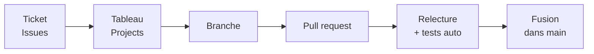

# Contribuer

## Les principes (non négociables)

1. **Rien sans source.** Chaque chiffre vient d'un fichier de `raw/` via un chargeur, avec sa ligne d'origine. Aucun
   chiffre, libellé officiel ou définition n'est écrit à la main.
2. **Aucune méthode inventée.** On n'additionne que le long d'une nomenclature officielle, dans une même source, avec
   le même stade, la même mesure et la même unité. Les agrégats OFGL et les nœuds COFOG sont emboîtés : on ne les
   additionne jamais entre eux.
3. **Un trou n'est pas un zéro.** `nc`, `ε`, jeu non publié : une ligne dans la table `lacune`, avec l'organisme qui
   devrait publier.
4. **Définitions citées.** `content/concepts.yaml` : citation exacte et datée (Insee, OFGL, Légifrance). Sans
   définition officielle, le statut est `a_sourcer` et le site l'affiche.
5. **Neutralité.** Le texte d'interface décrit les données. Pas d'affirmation non sourcée, pas de score, pas de
   verdict, pas de lien de cause entre deux séries.

## En pratique

- **Une page = un module** dans `api/` (`depenses.py`, `territoires.py`…). `api/main.py` ne garde que l'application,
  le rendu et les aides partagées.
- **Arborescence courte** : quatre entrées de menu (Accueil, Thèmes, Ma collectivité, Sources, voir `api/portes.py`).
  Avant d'ajouter une page, chercher celle qui peut accueillir le contenu.
- **Nouvelle phrase d'interface** : l'écrire en français dans le gabarit avec `_("…")`, lancer `make i18n-extract`,
  ajouter l'anglais dans `locales/en_strings.py`, puis `make i18n`. Sinon `test_traductions_completes` échoue.
- **Tests** : vérifier la structure (`id`, `class`, `href`) et les chiffres, pas la formulation des phrases.
- **Avant de proposer** : `make build && make test`, puis un coup d'œil au site à 320 px de large et sur ordinateur
  (pas de défilement horizontal hors tableaux).
- **Feuille de route** : `docs/ROADMAP.md` est la seule liste de travail. Une tâche finie en est retirée.

## Travailler ensemble sur GitHub

1. **Tout part d'un ticket** (onglet *Issues*), avec l'un des modèles : problème, idée ou tâche, nouvelle source.
   On en discute avant de coder.
2. **Le tableau** (onglet *Projects*) range les tickets en colonnes : À faire, En cours, En relecture, Fait. C'est la
   roadmap au jour le jour. [ROADMAP.md](ROADMAP.md) garde la vision d'ensemble et les grands chantiers.
3. **Une branche par ticket**, nommée d'après lui : `12-page-dette`.
4. **Une pull request** qui ferme le ticket (« Ferme #12 »). Le modèle rappelle les vérifications. Les tests se lancent
   tout seuls à chaque pull request (`.github/workflows/ci.yml`).
5. **Relecture par l'autre personne**, puis fusion dans `main`. On ne pousse jamais directement sur `main`.

**Étiquettes** : `bug`, `idée`, `source`, `données`, `interface`, `traduction`, `bloqué`.
